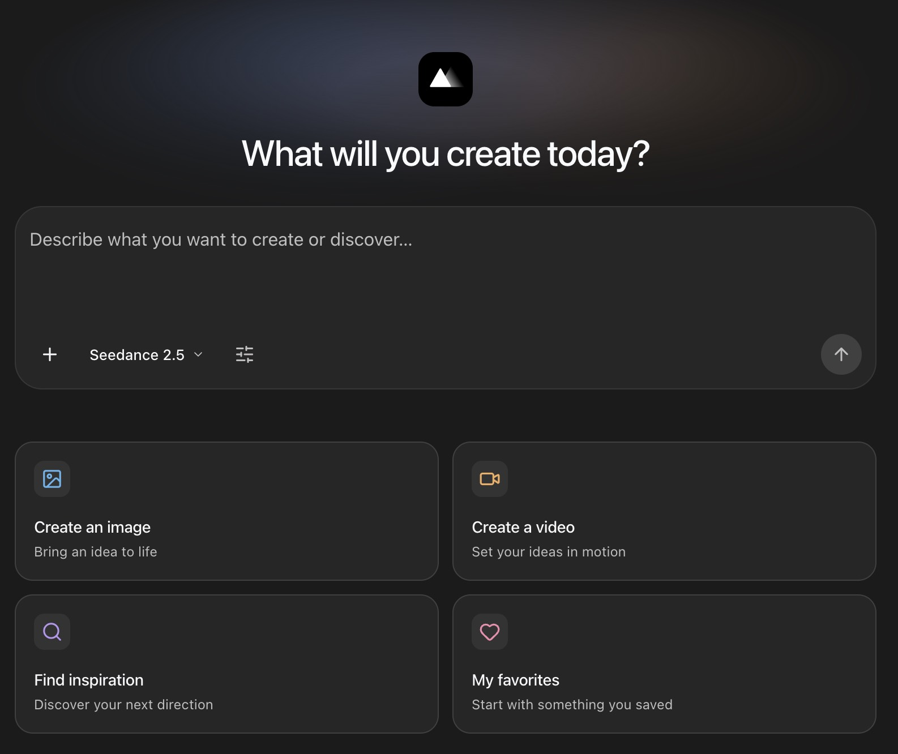

<h1 align="center">MeiGen AI Design MCP</h1>

<p align="center">
  <a href="SETUP.md"></a>
  <br><sub>Interactive interface available in MCP Apps-compatible clients. Interface support varies by client.</sub>
</p>

<p align="center">
  Discover inspiration. Create images and videos with the latest AI models.<br>
  Open-source MCP tools for ChatGPT, Claude, Cursor, OpenClaw and other AI assistants.
</p>

<p align="center">
  <a href="https://chatgpt.com/plugins/plugin_asdk_app_6ab66d24f56481919361b6c33f7c1928"></a>
  <a href="#remote-mcp"></a>
  <a href="#remote-mcp"></a>
  <a href="#openclaw"></a>
  <a href="#other-clients"></a>
</p>

<p align="center">
  <a href="https://www.npmjs.com/package/meigen"></a>
  <a href="LICENSE"></a>
  <a href="https://discord.gg/uX6rnersUx"></a>
</p>

<p align="center">
  <strong>English</strong> · <a href="README.zh-CN.md">中文</a><br>
  <a href="#quick-start">Quick start</a> · <a href="#skills">Capabilities</a> · <a href="#other-clients">Manual setup</a> · <a href="#documentation">Documentation</a>
</p>

## Quick start

<a id="chatgpt-web"></a>
<a id="codex"></a>

Bring MeiGen into the AI tool you already use:

| Client | Get started |
|---|---|
| **ChatGPT** | [Install from the official ChatGPT store](https://chatgpt.com/plugins/plugin_asdk_app_6ab66d24f56481919361b6c33f7c1928), then sign in to MeiGen. |
| **Claude** | [Connect remote MCP](#remote-mcp), or install the [Claude plugin](#claude-code) for creative commands and guides. |
| **Cursor / VS Code / Codex** | [Add the remote MCP URL](#remote-mcp) and sign in. [Client setup →](SETUP.md) |
| **OpenClaw** | [Install from ClawHub](#openclaw) and connect your MeiGen account. |
| **Other MCP clients** | Use [remote MCP](#remote-mcp), or the [npm bridge](#npm-bridge) if your client requires stdio. |

**Try it with inspiration first:**

> Use MeiGen to find minimalist product photography inspiration. Show me the reference images and prompts.

Then refine a direction, bring in your own references, or create something new. [Explore MeiGen →](https://www.meigen.ai)

Search and model/Skill lookups do not spend generation credits. Generation uses **purchased credits only**, not daily free credits; your assistant should check current prices before creating.

<a id="features"></a>
<a id="skills"></a>

## What you can do

| Capability | Try asking |
|---|---|
| **Find inspiration** | “Find cinematic portraits and show me their prompts.” |
| **Create images & videos** | “Create a product photo, then animate it into a short video.” |
| **Use reference media** | “Use this image, clip or audio to guide a compatible model.” |
| **Reuse characters** | “List my MeiGen characters and use this one in the video.” |
| **Bring your library** | “Find my saved references or the prompt from a previous creation.” |
| **Make product visuals** | “Make a hero shot, a close-up and a lifestyle image for this product.” |
| **Design marketing posters** | “Design a poster for our weekend coffee tasting.” |
| **Edit backgrounds & upscale** | “Remove this background,” “Try a studio setting,” or “Enhance this photo.” |

Provide a source image when needed. Your assistant checks live models, inputs and options before generating. [Explore the five visual Skills →](SKILLS_API.md)

### Pick up where you left off

Explore ideas on MeiGen, save them to boards, and continue in your AI conversation. With OAuth, you can browse favorites and past creations, read original prompts, save selected results, and manage references or characters with the relevant permissions.

Compatible MCP Apps hosts can show an interactive home, inspiration gallery, favorites, and generation cards with model-specific time estimates. Other hosts use text and media results; presentation depends on the client.

<a id="other-clients"></a>

## Connect MeiGen

<a id="remote-mcp"></a>

### Remote MCP — recommended

Add this **Streamable HTTP** URL in your client's MCP settings, then connect and sign in to MeiGen:

```text
https://www.meigen.ai/api/mcp
```

No Node.js installation or new API key is needed. Keep one MeiGen connection per client. Verify with “List MeiGen's available models and Skills”; account features request their own OAuth permissions. [Setup and troubleshooting →](SETUP.md)

<a id="npm-bridge"></a>

<details>
<summary><strong>npm bridge — for clients that require stdio</strong></summary>

[meigen@4.0.0](https://www.npmjs.com/package/meigen/v/4.0.0) connects to the same hosted service. Requires **Node.js 22.19+**; Node.js 24 is recommended.

```json
{
  "mcpServers": {
    "meigen": {
      "command": "npx",
      "args": ["-y", "meigen@4.0.0"]
    }
  }
}
```

New connections use browser OAuth. Existing MeiGen API keys remain supported for their compatible tools; private-library and character tools require OAuth. The bridge cannot read local file paths—use supported uploads or accessible image URLs.

Routine model and tool updates now arrive from the remote service. Refresh your tool list or reconnect; security or transport updates may still require a bridge update.

</details>

<a id="claude-code"></a>

<details>
<summary><strong>Claude plugin — creative commands and guides</strong></summary>

Run inside Claude, then restart and connect your MeiGen account:

```text
/plugin marketplace add jau123/MeiGen-AI-Design-MCP
/plugin install meigen@meigen-marketplace
```

The plugin now uses native remote MCP. It adds `/meigen:setup`, `/meigen:gen`, `/meigen:find`, `/meigen:models` and creative guides. Reuse an existing MeiGen connection when switching. [Plugin guide →](plugin/README.md)

</details>

<a id="openclaw"></a>

<details>
<summary><strong>OpenClaw — install from ClawHub</strong></summary>

Install [MeiGen from ClawHub](https://clawhub.ai/plugins/meigen-ai-design), then use OpenClaw's MCP connection settings to sign in:

```bash
openclaw plugins install clawhub:meigen-ai-design
```

The plugin combines creative guides with remote tools. Its ClawHub version is independent of npm; the standalone `creative-toolkit` Skill is not needed alongside it. [Connection guide →](SETUP.md)

</details>

<a id="install-with-ai"></a>

<details>
<summary><strong>Let your coding assistant set it up</strong></summary>

```text
Set up MeiGen using https://github.com/jau123/MeiGen-AI-Design-MCP#quick-start.
Detect my client, preserve other servers, and reuse any existing MeiGen connection.
Prefer remote HTTP with OAuth; let me sign in through the host, not through chat.
Verify with list_models and list_skills, without uploading or generating.
```

</details>

<a id="upgrading"></a>

### Upgrading from 3.x?

**4.0 is a remote bridge.** BYOK, local file processing/downloads, local preferences, prompt enhancement and `meigen gen` remain in [3.4.0](https://github.com/jau123/MeiGen-AI-Design-MCP/tree/v3.4.0). Keep that version if you need these features. Existing version pins do not auto-upgrade. [Migration and rollback →](MIGRATION.md)

## Documentation

- [Client setup & troubleshooting](SETUP.md) · [4.0 release notes](RELEASE_NOTES_4.0.0.md)
- [Visual Skills API & examples](SKILLS_API.md) · [Compose image/video workflows](COMPOSABLE_WORKFLOWS.md)
- [Claude plugin guide](plugin/README.md) · [Maintainer release guide](RELEASING.md)

If a generation is interrupted, ask to check the original task before starting another paid request. Keep the original request ID and download results you want to retain.

## Community & license

[Discord](https://discord.gg/uX6rnersUx) · [Issues](https://github.com/jau123/MeiGen-AI-Design-MCP/issues) · [MeiGen](https://www.meigen.ai) · [Privacy policy](https://www.meigen.ai/privacy-policy)

MCP community: [Awesome MCP Servers](https://github.com/punkpeye/awesome-mcp-servers) · [MeiGen in wshobson/agents](https://github.com/wshobson/agents/tree/main/plugins/meigen-ai-design).

[MIT](LICENSE) licensed client bridge and creative guides. Hosted service implementation is separate; cloud generation uses paid credits.
