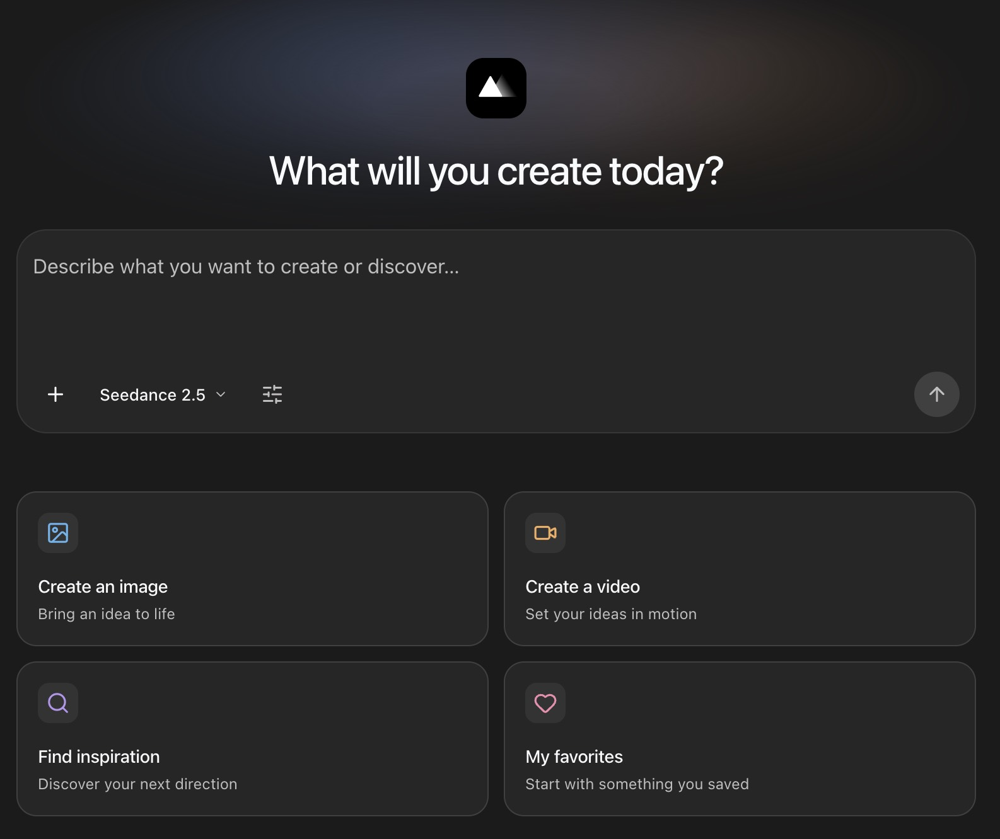

<h1 align="center">MeiGen AI Design MCP</h1>

<p align="center">
  <a href="SETUP.md"></a>
  <br><sub>交互界面适用于支持 MCP Apps 的客户端，具体支持情况因客户端而异。</sub>
</p>

<p align="center">
  发现灵感，使用最新 AI 模型创建图片和视频。<br>
  为 ChatGPT、Claude、Cursor、OpenClaw 及其他 AI 助手提供开源 MCP 工具。
</p>

<p align="center">
  <a href="https://chatgpt.com/plugins/plugin_asdk_app_6ab66d24f56481919361b6c33f7c1928"></a>
  <a href="#remote-mcp"></a>
  <a href="#remote-mcp"></a>
  <a href="#openclaw"></a>
  <a href="#other-clients"></a>
</p>

<p align="center">
  <a href="https://www.npmjs.com/package/meigen"></a>
  <a href="LICENSE"></a>
  <a href="https://discord.gg/uX6rnersUx"></a>
</p>

<p align="center">
  <a href="README.md">English</a> · <strong>中文</strong><br>
  <a href="#快速开始">快速开始</a> · <a href="#skills">功能</a> · <a href="#other-clients">手动配置</a> · <a href="#文档">文档</a>
</p>

## 快速开始

<a id="chatgpt-web"></a>
<a id="codex"></a>

把 MeiGen 带入你正在使用的 AI 工具：

| 客户端 | 开始使用 |
|---|---|
| **ChatGPT** | [从 ChatGPT 官方商店安装](https://chatgpt.com/plugins/plugin_asdk_app_6ab66d24f56481919361b6c33f7c1928)，然后登录 MeiGen。 |
| **Claude** | [连接远程 MCP](#remote-mcp)，或安装附带创作命令和指南的 [Claude 插件](#claude-code)。 |
| **Cursor / VS Code / Codex** | [添加远程 MCP 地址](#remote-mcp)并登录。[客户端配置 →](SETUP.zh-CN.md) |
| **OpenClaw** | [从 ClawHub 安装](#openclaw)，然后连接 MeiGen 账号。 |
| **其他 MCP 客户端** | 使用[远程 MCP](#remote-mcp)；仅支持 stdio 的客户端可用 [npm 连接桥](#npm-bridge)。 |

**先从搜索灵感开始：**

> 用 MeiGen 找一些极简产品摄影灵感，展示参考图片和提示词。

接着细化方向、加入自己的参考素材，或直接开始创作。[探索 MeiGen →](https://www.meigen.ai)

搜索、模型和 Skill 查询不消耗生成积分。生成**仅使用购买积分**，不使用每日免费积分；创作前应由助手查询当前价格。

<a id="features"></a>
<a id="skills"></a>

## 可以做什么

| 功能 | 试着这样问 |
|---|---|
| **寻找灵感** | “找一些电影感人像，展示它们的提示词。” |
| **生成图片和视频** | “生成一张产品图，再把它变成短视频。” |
| **使用参考素材** | “用这张图片、视频片段或音频引导支持的模型。” |
| **复用角色** | “列出我的 MeiGen 角色，把这个角色用到视频里。” |
| **带入个人资料库** | “找到我收藏的参考图，或之前作品的提示词。” |
| **制作商品视觉** | “为这个产品制作主图、特写和生活场景图。” |
| **设计营销海报** | “为周末咖啡品鉴活动设计一张海报。” |
| **编辑背景与放大** | “移除背景”“换成摄影棚场景”或“增强这张照片”。 |

任务需要原图时请提供素材。助手会先检查当前模型、输入要求和可选参数，再开始生成。[了解五项视觉 Skills →](SKILLS_API.md)

### 从上次的灵感继续

在 MeiGen 浏览灵感、收藏到画板，再到 AI 对话里继续。通过 OAuth，你可以浏览收藏和历史作品、读取原始提示词、保存选定结果，并在相应权限下管理参考素材或角色。

支持 MCP Apps 的客户端可展示交互首页、灵感广场、收藏和带模型估时的生成卡片；其他客户端使用文字和媒体结果，具体呈现由客户端决定。

<a id="other-clients"></a>

## 连接 MeiGen

<a id="remote-mcp"></a>

### 远程 MCP — 推荐

在客户端的 MCP 设置中添加以下 **Streamable HTTP** 地址，然后连接并登录 MeiGen：

```text
https://www.meigen.ai/api/mcp
```

无需安装 Node.js，也无需创建新的 API Key。每个客户端保留一个 MeiGen 连接即可。用“列出 MeiGen 当前可用的模型和 Skills”验证连接；账户功能会请求对应的 OAuth 权限。[配置与常见问题 →](SETUP.zh-CN.md)

<a id="npm-bridge"></a>

<details>
<summary><strong>npm 连接桥 — 适用于仅支持 stdio 的客户端</strong></summary>

[meigen@4.0.0](https://www.npmjs.com/package/meigen/v/4.0.0) 连接到同一远程服务。需要 **Node.js 22.19+**，推荐 Node.js 24。

```json
{
  "mcpServers": {
    "meigen": {
      "command": "npx",
      "args": ["-y", "meigen@4.0.0"]
    }
  }
}
```

新连接使用浏览器 OAuth。已有 MeiGen API Key 可继续调用兼容工具；私有收藏和角色工具需要 OAuth。连接桥不能读取本机文件路径，请使用支持的上传方式或可访问的图片 URL。

常规模型和工具更新由远程服务提供，刷新工具列表或重连即可；安全或传输层更新仍可能需要升级连接桥。

</details>

<a id="claude-code"></a>

<details>
<summary><strong>Claude 插件 — 创作命令和指南</strong></summary>

在 Claude 内运行以下命令，然后重启并连接 MeiGen 账号：

```text
/plugin marketplace add jau123/MeiGen-AI-Design-MCP
/plugin install meigen@meigen-marketplace
```

插件现已使用原生远程 MCP，提供 `/meigen:setup`、`/meigen:gen`、`/meigen:find`、`/meigen:models` 和创作指南。切换时复用已有的 MeiGen 连接。[插件指南 →](plugin/README.md)

</details>

<a id="openclaw"></a>

<details>
<summary><strong>OpenClaw — 从 ClawHub 安装</strong></summary>

安装 [ClawHub 的 MeiGen 插件](https://clawhub.ai/plugins/meigen-ai-design)，再到 OpenClaw 的 MCP 连接设置中登录：

```bash
openclaw plugins install clawhub:meigen-ai-design
```

插件包含创作指南和远程工具。ClawHub 版本与 npm 独立发布；安装插件后无需重复安装独立的 `creative-toolkit` Skill。[连接指南 →](SETUP.zh-CN.md)

</details>

<a id="install-with-ai"></a>

<details>
<summary><strong>让编程助手帮你配置</strong></summary>

```text
请参考 https://github.com/jau123/MeiGen-AI-Design-MCP#quick-start 配置 MeiGen。
识别当前客户端，保留其他服务，并复用已有的 MeiGen 连接。
优先使用远程 HTTP 与 OAuth，让我通过客户端登录，不在聊天里提供凭据。
用 list_models 和 list_skills 验证连接，不上传、不生成。
```

</details>

<a id="upgrading"></a>

### 从 3.x 升级？

**4.0 是远程连接桥。** BYOK、本地文件处理／下载、本地偏好、提示词增强和 `meigen gen` 留在 [3.4.0](https://github.com/jau123/MeiGen-AI-Design-MCP/tree/v3.4.0)。依赖这些功能的工作流请保留旧版；固定版本的安装不会自动升级。[迁移与回退 →](MIGRATION.md)

## 文档

- [客户端配置与常见问题](SETUP.zh-CN.md) · [4.0 发布说明](RELEASE_NOTES_4.0.0.md)
- [视觉 Skills 使用指南与示例](SKILLS_API.md) · [编排图片／视频工作流](COMPOSABLE_WORKFLOWS.zh-CN.md)
- [Claude 插件指南](plugin/README.md) · [维护者发布指南](RELEASING.md)

生成中断时，先让助手查询原任务，再决定是否重新付费生成。保留原始请求 ID，并下载需要长期保存的结果。

## 社区与许可

[Discord](https://discord.gg/uX6rnersUx) · [问题反馈](https://github.com/jau123/MeiGen-AI-Design-MCP/issues) · [MeiGen](https://www.meigen.ai) · [隐私政策](https://www.meigen.ai/privacy-policy-zh)

MCP 社区：[Awesome MCP Servers](https://github.com/punkpeye/awesome-mcp-servers) · [wshobson/agents 中的 MeiGen](https://github.com/wshobson/agents/tree/main/plugins/meigen-ai-design)。

客户端连接桥与创作指南使用 [MIT](LICENSE) 许可。托管服务实现独立维护，云端生成使用购买积分。
